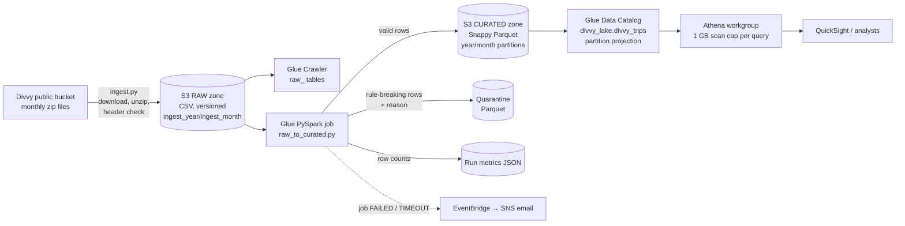
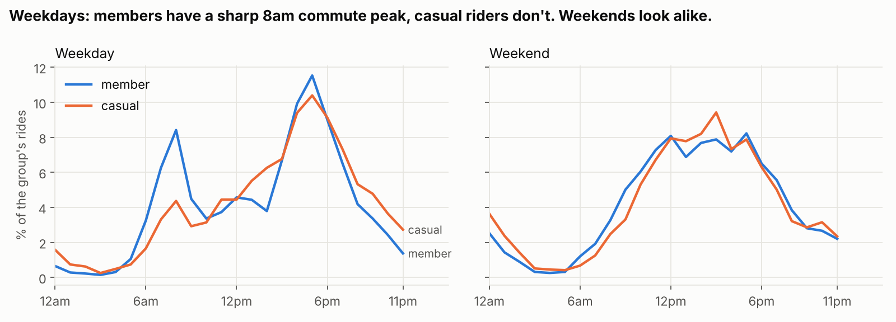
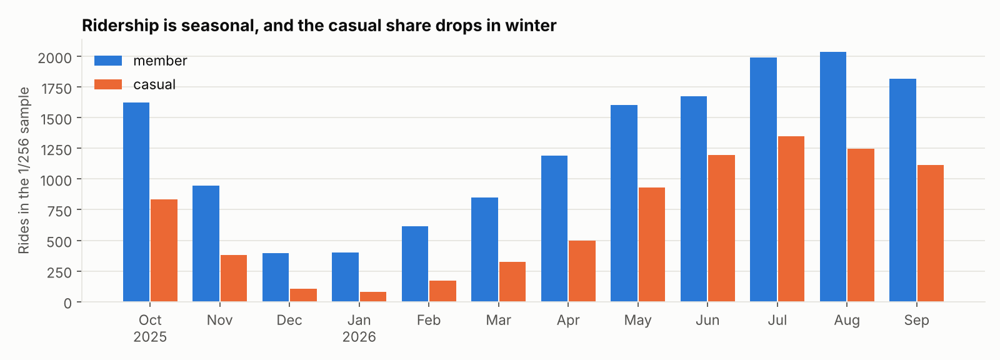
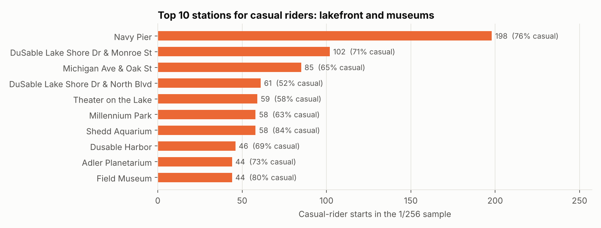

# Chicago Divvy Lakehouse on AWS

An end-to-end AWS data lakehouse for Chicago's Divvy bike-share trips:
**S3 raw → Glue (PySpark) ETL with data-quality quarantine → partitioned Parquet → Athena SQL**,
deployed with **CloudFormation**, tested with **pytest**, and checked by **GitHub Actions CI**.

The same transformation code runs in AWS Glue and on a laptop, so the whole pipeline can be run and
verified locally in about a minute with no AWS account.

`Python` `PySpark` `AWS Glue` `Amazon S3` `Amazon Athena` `CloudFormation` `SQL` `Parquet` `DuckDB` `pytest` `GitHub Actions`

---

## The business question

Divvy's goal is to grow annual memberships. For a "convert casual riders" campaign, marketing needs to know:

1. How do members and casual riders use the bikes differently?
2. When and where are casual riders easiest to reach?

The data team needs a pipeline that lands every monthly file reliably, rejects bad records visibly
instead of silently, and keeps query costs low as history grows.

## Architecture



| Layer | AWS service | Design choice and why |
|---|---|---|
| Raw zone | S3 (versioned, encrypted) | Files land unchanged in Hive-style folders. Versioning means a bad re-upload can be undone. Moves to Glacier Instant Retrieval after 90 days because raw is rarely re-read. |
| Discovery | Glue Crawler | Catalogs the raw CSVs. Schema changes are **logged, not applied**, so a Divvy format change can't silently break the pipeline. |
| Transform | Glue 5.0 job (Spark 3.5) | Logic lives in `src/divvy_lakehouse/transform.py` and is shipped to Glue as a zip, so the tested code is the deployed code. 2 workers, 30-minute timeout. |
| Data quality | Inside the job | 11 rules. Each failing row gets the **first** rule it breaks as `dq_reason` and goes to quarantine. Nothing is dropped silently: `curated + quarantine = rows read`, and a test enforces it. |
| Curated zone | S3, Snappy Parquet | Partitioned by ride-start `year`/`month`. One file per partition avoids the small-files problem. |
| Catalog | Glue table defined in CloudFormation | Code-reviewed schema. **Partition projection** means no crawler or `MSCK REPAIR` is needed after each load. |
| Query | Athena workgroup | Enforced settings, results expire after 7 days, and a **1 GB scan cap per query** as a cost guardrail. |
| Ops | EventBridge + SNS | Email alert when the Glue job fails or times out. Optional monthly Glue trigger. |

## Data

* **Source:** [Divvy system data](https://divvybikes.com/system-data), published by Lyft Bikes and
  Scooters under the [Divvy Data License Agreement](https://divvybikes.com/data-license-agreement):
  one CSV per month, 13 columns, one row per ride.
* **What's committed here:** a deterministic **1-in-256 sample** of the 12 monthly files from
  Oct 2025 to Sep 2026. It keeps every ride whose `ride_id` ends in `00`, which gives **24,019 rides**
  in their original format (`data/sample/raw/`). The ids are random hex, so this is effectively a
  uniform random sample. The sample was taken from the public repo
  [anishkaranth/da-learn-25-bike-share-trips](https://github.com/anishkaranth/da-learn-25-bike-share-trips).
* **Test fixture:** 1,268 deliberately awkward real rows from the same source
  (`tests/fixtures/edge_case_rides.csv`): cross-file duplicates, daylight-saving negative durations,
  test and warehouse stations, rides over 24 hours, and coordinates outside Chicago.
* **Full data:** `scripts/deploy.sh` downloads the complete months (about 6 million rides) straight
  from Divvy into S3.

## Results (from the sample)

All numbers below come from running this pipeline on the 1/256 sample (`docs/results/`).
Percentages and medians are sample estimates. Counts are sample counts, not city totals.

**Pipeline run:** 24,019 rows read → **23,384 curated**, **635 quarantined (2.6%)**:

| Rule | Rows |
|---|---|
| too_short_under_1_min (false starts, re-docks) | 614 |
| too_long_over_24h (lost or unreturned bikes) | 19 |
| missing_end_location | 1 |
| outside_service_area | 1 |

The edge-case fixture also exercises `duplicate_ride_id`, `non_positive_duration`,
`non_customer_station` and `outside_service_area`. Those are rare in the random sample but
real in the full data.

Writing Parquet without repartitioning first produced **2,368 tiny files totalling 33 MB, 7×
the raw CSV**. With `repartition("year", "month")` the curated zone is **12 files and 1.9 MB, 60%
smaller than raw**.

### Members vs casual riders

| | Share of rides | Median ride | Round trips | Weekend rides |
|---|---|---|---|---|
| **Members** | 64.8% | 8.8 min | 1.5% | 23.0% |
| **Casual** | 35.2% | 11.2 min | 4.9% | 37.8% |



* **Members commute.** On weekdays, 8.4% of members' rides start in the 8am hour, versus 4.4% for
  casual riders. On weekends the two groups ride at almost the same times.
* **Casual riders ride for leisure.** Their rides are longer (11.2 vs 8.8 minutes median), they take
  3× as many round trips, and a larger share of their rides fall on weekends.



* **Strong seasonality.** The casual share of rides falls from **41.7% in June 2026** to **16.7% in
  January 2026**. Members keep riding through winter; casual riders mostly stop.
* **E-bikes dominate.** 71% of curated rides are on electric bikes, and about 29% of e-bike rides
  start away from any dock.



* **Where to reach casual riders:** the lakefront and the Museum Campus. At Navy Pier, Shedd
  Aquarium, Field Museum and Adler Planetarium, 73–84% of starts are casual riders.

### Recommendation

Run the membership campaign **May to September** at **lakefront and museum stations**. Pitch the
weekend and leisure value of membership (longer rides, round trips) rather than commuting, since
casual riders aren't commuting. Measure it with this pipeline: the monthly casual-to-member mix at
target stations, compared with other stations.

## Run it locally (no AWS account needed)

Requires Python 3.11+ and Java 17+ (for Spark).

```bash
pip install -r requirements.txt
python scripts/run_local.py     # ingest sample → Spark ETL → DuckDB runs the Athena SQL
python scripts/make_charts.py   # rebuild the charts in docs/img/
python -m pytest -q             # 23 tests
cfn-lint infra/template.yaml    # validate the CloudFormation template
```

Locally, folders stand in for S3 (`lake/raw`, `lake/curated`, `lake/quarantine`) and DuckDB stands in
for Athena. The only SQL translation needed is `approx_percentile` → `quantile_cont`
(`scripts/run_queries.py`).

## Deploy to AWS

```bash
aws configure                                   # an account you own
ALERT_EMAIL=you@example.com ./scripts/deploy.sh # stack + upload + ingest 12 months + run the job
# then in the Athena console: workgroup divvy-lakehouse-wg, database divvy_lake, run sql/athena/02_*.sql
./scripts/teardown.sh                           # empty buckets and delete everything
```

**Cost (us-east-1, rough):** a Glue run on 2 G.1X workers for a few minutes is about $0.10–0.20 per
run, plus Athena at $5 per TB scanned (a few cents for all of these queries) and well under $1 a month
of S3 storage. Run `teardown.sh` when you're done.

## Repository layout

```
src/divvy_lakehouse/transform.py   all transformation + data-quality logic (shared by Glue and local)
src/divvy_lakehouse/ingest.py      Divvy download → raw zone (S3 or local)
glue_jobs/raw_to_curated.py        thin Glue wrapper around transform.py
infra/template.yaml                CloudFormation: S3, Glue, IAM, Athena, EventBridge, SNS
sql/athena/                        DDL + 6 analytics queries (Athena / Trino SQL)
scripts/                           run_local, run_queries, make_charts, deploy, teardown
tests/                             23 pytest tests incl. real-data edge cases
docs/results/, docs/img/           query outputs and charts from the last local run
learn/walkthrough.md               plain-language guide to every part of the project
```

## What I'd do next

* Make loads incremental: use Glue job bookmarks or process only the newly landed `ingest_month`
  instead of reprocessing all history.
* Add Lake Formation column-level permissions, for example hiding raw coordinates from the
  marketing role.
* Move data-quality rules to AWS Glue Data Quality (DQDL) so results show up in the console.
* Build a QuickSight dashboard on the Athena table, and join a weather dataset to explain daily demand.
